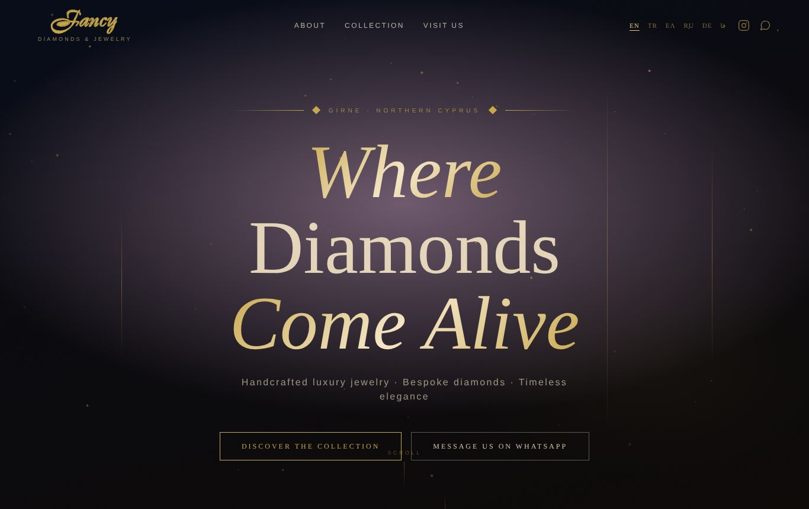

# Fancy Diamonds & Jewelry — Girne

Website for **Fancy Diamonds & Jewelry**, a jewelry shop on Ziya Rızkı Caddesi in Girne (Kyrenia), Northern Cyprus.

**Live:** https://alirezamahdavishirkharkolaei.github.io/fancy-jewelry/

<p>
  
  
</p>

## Features

- **Six languages:** English, Türkçe, Ελληνικά, Русский, Deutsch and فارسی. Persian uses a full right-to-left layout.
  - The language is chosen from the `?lang=` link, then the visitor's saved choice, then the browser language.
  - The page title, the description and the WhatsApp messages are translated too.
- **The collection comes from the shop's own Instagram.**
  - Each piece is a real post, shown with Instagram's official embed and linked back to the post.
  - No prices are shown; each piece says "Price on request".
  - Every piece has an **"Ask about this piece"** button. It opens WhatsApp with a message, in the visitor's language, that contains the post link.
- **Contact:**
  - WhatsApp and phone number, email and Instagram links.
  - Opening hours.
  - A map with a *Get directions* link.
  - `JewelryStore` structured data, so Google can show the address, hours and phone number.
- **The original logo**, converted from the CorelDRAW file to a crisp SVG whose colour is controlled by CSS (`brand/`).
- **Fast and accessible:**
  - The CSS is compiled with Tailwind, replacing the play CDN.
  - There are no stock photos.
  - The gold particles pause once the hero section scrolls out of view.
  - `prefers-reduced-motion` is respected.
  - The page has a skip link, an accessible mobile menu, and keyboard-visible focus.

## Add pieces from Instagram

Open [`assets/js/config.js`](assets/js/config.js) and add one line per post:

```js
export const POSTS = [
  { url: "https://www.instagram.com/p/XXXXXXXXXXX/", category: "rings" },
  { url: "https://www.instagram.com/p/YYYYYYYYYYY/", category: "necklaces" },
];
```

The categories are `rings`, `necklaces`, `earrings`, `bracelets`, `watches` and `sets`. The filter buttons appear by themselves once two or more categories are used. If there are no posts, the section invites visitors to follow the shop on Instagram or to message on WhatsApp instead.

Shop details (address, phone, hours, Instagram handle) also live in `config.js`.

## Develop

```bash
npm ci
npm run build:css    # compile assets/css/input.css → assets/css/site.css
npm test             # translations complete, every key used exists, links and data valid
python3 -m http.server 8000
```

The `site` workflow runs the tests on every push, checks that the compiled CSS is up to date, and deploys `main` to GitHub Pages.

## Credits

Built by **Alireza Mahdavishirkharkolaei** for Fancy Diamonds & Jewelry. The logo and the Instagram content belong to the shop.
